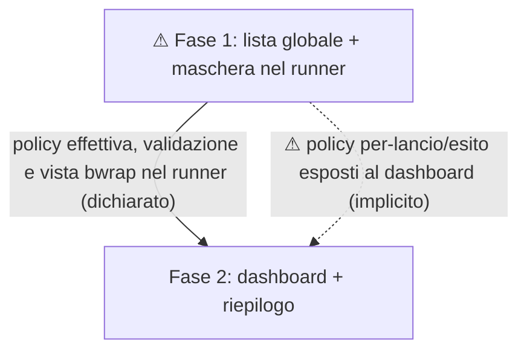

# Walkthrough del PRD — masking opt-in dei mount LINCE

- **Fonte:** [PRD nell'issue #400](https://github.com/RisorseArtificiali/lince/issues/400) (19 ottobre 2026; versione v1 nel titolo; revisionato durante il walkthrough). L'originale era fuori da Git al momento della revisione; questa è la copia versionabile del dossier.
- **Modalità:** EDIT; ogni modifica al PRD richiede approvazione del testo prima/dopo.
- **Data / base codice:** 19 ottobre 2026; `/home/alessio/workspaces/lince` su `main`, commit `d52f0d9` (repository aggiornato dall'utente prima della verifica del codice).
- **Scopo dichiarato:** configurare globalmente, in modo opt-in, i punti di mount da mascherare nelle sandbox bwrap; mantenere accesso e scrittura nella workdir, comportamento senza opt-in invariato, errore esplicito sui backend incompatibili.
- **Fonti di confronto:** [accordo v1](../design/mount-visibility-v1.md), [spike](mount-visibility-spike-2026-10-19.md) e [domande differite](../design/mount-visibility-open-questions.md); [`CLAUDE.md`](../../CLAUDE.md); [`config-v2-design.md`](../design/config-v2-design.md). Le prove sintetiche dello spike non sostituiscono test sull'host `Dati`.

## Backbone e dipendenze

1. **Fase 1 / Task 1:** lista globale nei due formati, validazione, policy nei lanci diretti `agent-sandbox` (`run` e `learn`), test su mount sintetico e `Dati`, documentazione sandbox.
2. **Fase 2 / Task 2:** lanci dashboard, errori e riepilogo della policy, aggiornamento ai lanci successivi, test di integrazione e documentazione dashboard.

**Test di cancellazione:** la fase 1 è utilizzabile e rilasciabile **solo come opt-in direct-only esplicitamente dichiarato**; se la fase 2 non arriva, il dashboard non deve essere presentato come protetto. Il PRD lo dice ora nell'out-of-scope di fase 1 e nella relativa documentazione.

## Tracciabilità (requisito → fase → criterio verificabile)

| Requisito del PRD | Fase/task | Criteri principali |
|---|---|---|
| Opt-in, comportamento predefinito invariato | 1/1 | 37, 118 |
| Config globale v2/legacy, precedenza e divieto locale | 1/1; test dashboard 2/2 | 38–41, 58; 119–122, 139; 90, 169 |
| Path valido, mount assente e backend incompatibile | 1/1; errore UI 2/2 | 42–45, 54–56, 60; 82, 90 |
| Sibling nascosti, workdir persistente, scritture altrove effimere, symlink | 1/1 | 46–53, 59, 61–64 |
| Ogni livello bwrap, incluso learn | 1/1; dashboard 2/2 | 57, 61; 80–81, 90 |
| Riepilogo della policy richiesta e limiti dichiarati | 2/2 | 83–87, 91 |
| Modifiche valide per i nuovi lanci, non per quelli esistenti | 2/2 | 88–89, 91 |
| Documentazione e test entro ciascuna fase | 1/1 e 2/2 | 58–66; 90–91 |

Nessun requisito dichiarato senza una fase; i criteri della task breakdown replicano quelli delle fasi. La prova di non persistenza delle scritture esterne è stata resa esplicita nel criterio del mount di test (sezione 10).

## Mappa delle assunzioni (stato sulla base codice aggiornata)

| Affermazione o presupposto | PRD | Stato | Evidenza / verifica mancante |
|---|---:|:---:|---|
| Root ro e home mascherata prima del bind progetto nel builder ordinario | 3, 17 | ✓ | `sandbox/agent-sandbox:build_bwrap_cmd` (~3144–3229). |
| La precedenza v2 > legacy esiste nel resolver v2, **ma anche il runner diretto la applica già** | 14, 39 | ✗ per il presupposto sul runner; non è un'affermazione esplicita del PRD | `lince-config/lince-config:build_resolved_view` (~2038–2107) applica lo switch; `sandbox/agent-sandbox:load_config` (~1279–1305) legge solo legacy. Il PRD la richiede come comportamento futuro. |
| Definizioni locali intercettabili prima del merge | 40 | ✓ come possibilità, non come comportamento attuale | `sandbox/agent-sandbox:find_config`, `load_config` (~1248–1305). Il campo non esiste ancora; rilevazione v2 da progettare. |
| Un solo builder gestisce già run e learn | 55 | ✗ come presupposto implementativo | `cmd_run:build_bwrap_cmd` (~5469); `cmd_learn:build_learn_bwrap_cmd` (~8020); il learn monta home RW (~7718–7723). Non è affermazione esplicita del PRD. |
| Maschera + bind workdir nascondono sibling e preservano scritture sul mount reale | 45–50 | ? | Spike sintetico sez. «Maschera e workdir» positivo; servono test nel runner e host `Dati`. |
| Landlock consente scrittura sulla nuova vista tmpfs | 17, 50 | ? | `build_bwrap_cmd` (~3499–3527) usa `bwrap_rw_targets` (~4121–4149); serve verifica d'integrazione/esecuzione, non va ignorato. |
| Il dashboard passa per il runner anche per backend nono/nessuno | 78–80 | ✗ come presupposto implementativo | `lince-dashboard/plugin/src/agent.rs:synthesize_sandboxed_command` (~228–385) gestisce nono e None separatamente; serve fail-closed prima dello spawn. Non è affermazione esplicita del PRD. |
| Il dashboard ricarica già la configurazione a ogni lancio | 86 | ✗ come presupposto implementativo | `plugin/src/main.rs:load`, `handle_key` (~599–612, 1357–1372); risolve all'avvio e all'apertura wizard. Il PRD chiede di aggiungere il comportamento. |
| Il dashboard può mostrare l'esito effettivo per-lancio | 81–85 | ? | `sandbox/agent-sandbox:build_policy_record`, `cmd_run` (~5631–5694); `plugin/src/main.rs:update` (~794–829) fa polling; nuovi campi e feedback di errore da definire. |
| Il plugin può leggere direttamente file host | 86 | ✗ come presupposto implementativo | `lince/CLAUDE.md` 22–25 impone `run_command()`; `plugin/src/config.rs:resolve_config_async` segue il pattern. Non è affermazione esplicita del PRD. |
| Overrides sperimentali possono riesporre contenuti | 7, 84 | ✓ | `sandbox/agent-sandbox:load_experimental_overrides`, `build_bwrap_cmd` (~3873–3905, 3487–3502); accordo v1 22, 25. |

✗ contrassegna un'ipotesi tecnica che sarebbe falsa **se assunta già vera oggi**; il PRD in genere specifica funzionalità da implementare, non afferma che esistano già. Non trasformare queste righe in «errori del PRD» senza verificare un contrasto testuale.

## Semaforo finale (scansione e triage)

| Dimensione | Stato | Perché / puntatore |
|---|:---:|---|
| 1. Problema e obiettivo | 🟢 | Problema concreto e confine per-path esplicitamente accettato (§ Problema, non-goal; registro 12). |
| 2. Ambiguità e completezza | 🟡 | Precedenza, chiavi, locale, banner e path essenziali chiariti; più mount configurati/annidati non esaminati in dettaglio (§ Decisions; Fase 1). |
| 3. Fasi | 🟢 | Fase 1 rilasciabile dichiarando direct-only; dashboard come dipendenza di rilascio per garanzia LINCE-wide (§ Fasi 1–2). |
| 4. Criteri | 🟡 | Scritture effimere, precedenza, locale e overlap learn resi espliciti; overlap con directory temporanee non ha fixture dedicata (§ Fase 1 AC). |
| 5. Realtà del codice | 🟡 | Gap runner v2, learn separato, backend dashboard bypass chiariti come lavoro da eseguire, non verificati runtime (§ Decisioni; Fasi 1–2). |
| 6. Coerenza | 🟢 | Accordo v1 rispettato; precedenza Config v2 e scope learn esplicitati (§ Decisions; accordo e config-v2-design). |
| 7. Scope/YAGNI | 🟢 | Perimetro per-path e due formati approvati; banner runner scelto per semplicità (§ Decisioni; Fase 2). |
| 8. Impatti | 🟡 | Documentazione e refresh specificati; ancora da realizzare feedback d'errore del dashboard (§ Fase 2). |

## Registro walkthrough

- Modalità scelta: EDIT; ordine per criticità.
- **1 · Precedenza config — correzione approvata e applicata.** Prima: «following LINCE's existing precedence when both are present». Dopo: decisione esplicita che per `run`/`learn` il v2 globale presente è l'unica fonte (anche lista vuota), v2 invalido fallisce senza fallback, altrimenti vale legacy globale. File PRD § Decisions. Restano aperti gli indirizzi TOML e la definizione di locale.
- **2 · Ambito config locale — correzione approvata e applicata.** Prima: «A project-local configuration that attempts to define the list is an error». Dopo: il divieto vale anche per lista vuota e formato globale non selezionato; `run` controlla directory di invocazione e workdir `-p`, `learn` la workdir, dashboard la directory di avvio e la workdir scelta. File PRD § Decisions. Resta da decidere l'indirizzo TOML.
- **3 · Indirizzi TOML — correzione approvata e applicata.** Prima: nessuna chiave nominata. Dopo: `[filesystem].mask_mount_points` in Config v2 e `[sandbox].mask_mount_points` in legacy, liste di path di directory assoluti e global-only. File PRD § Decisions.
- **4 · Falso successo dashboard — correzione approvata e applicata.** Prima: «The dashboard displays the error and does not launch the agent when the selected backend cannot enforce the rule». Dopo: con lista attiva, l'agente non parte su backend incompatibile, il dashboard segnala il rifiuto con motivo e non lo dichiara avviato. Applicato ai criteri di fase 2 e Task 2.
- **5 · Riepilogo — correzione approvata e applicata.** L'utente ha scelto la via tecnicamente più semplice: banner nel pane del runner, leggibile riaprendo il pane se nascosto. Prima: «startup summary lists the configured paths that were masked». Dopo: elenco dei mount richiesti per il masking nel pane runner, senza attestare che siano nascosti se gli override sperimentali sono attivi. Applicato ai criteri di fase 2 e Task 2. Trade-off UX accettato: non è richiesto duplicare il riepilogo nella UI dashboard.
- **6 · Aggiornamento dashboard — correzione approvata e applicata.** Prima: «Changing the global list changes the view of an agent launched afterward without restarting the dashboard». Dopo: i nuovi lanci dopo la modifica usano la lista aggiornata o falliscono sul backend incompatibile; vale per wizard, quick spawn e agenti ripristinati. Applicato ai criteri di fase 2 e Task 2.
- **7 · Overlap learn/bind automatici — correzione approvata e applicata.** Prima: nessun caso esplicito di sovrapposizione. Dopo: se un punto configurato interseca home scrivibile in `learn`, directory temporanee o altri path rimontati automaticamente, fuori workdir restano invisibilità e scritture effimere a tutti i livelli; se impossibile senza rompere il runtime, lancio rifiutato. Applicato ai criteri di fase 1 e Task 1. L'esito runtime resta da verificare con test.
- **8 · `/run` essenziale — correzione approvata e applicata.** Prima: solo `/`, `/proc`, `/dev` nominati nei criteri. Dopo: rifiutare anche `/run` esatto; un mount discendente di `/run` (es. `Dati`) non è respinto solo per questo. Applicato a fase 1 e Task 1. Chiarimento chiesto dall'utente: anche `/` è vietato come valore esatto, non vieta un mount `/pippo` sotto la radice.
- **9 · Cancellazione fase 2 / rilascio — correzione approvata e applicata.** Prima: solo verifica e banner dashboard fuori dalla fase 1, senza confine di rilascio esplicito. Dopo: fase 1 rilasciabile direct-only, dashboard enforcement e verifica in fase 2, nessuna promessa di protezione dashboard finché fase 2 non passa. Aggiunto obbligo di dichiararlo nella doc della fase 1 e Task 1.
- **10 · Scritture effimere — correzione approvata e applicata.** Prima: il criterio dei test su mount di prova verificava solo persistenza in workdir. Dopo: verifica che scritture fuori workdir riescano nella sandbox ma non lascino file sul host dopo la sua uscita. Applicato ai criteri di fase 1 e Task 1.
- **11 · Test overlap in `learn` — correzione approvata e applicata.** Prima: «Tests verify masking at each available bwrap level, including learn». Dopo: il caso home scrivibile in learn richiede sibling preesistente illeggibile, scrittura fuori workdir assente sul host, scrittura nella workdir persistente, oppure fallimento esplicito prima dell'avvio dell'agente. Applicato ai criteri di fase 1 e Task 1.
- **12 · Perimetro v1 — trade-off accettato.** L'utente conferma il confine per percorso configurato; non richiede protezione generale contro alias non configurati, nuovi mount host o bind espliciti. Supporto di entrambi i formati e check host `Dati` restano in v1 come da accordo. Il banner nel pane runner riduce la complessità UI; le prove del comportamento rimangono criteri da eseguire, non risultati già certificati.
- **13 · Test config locale — correzione approvata e applicata.** Prima: test generici per definizioni locali, nessuna menzione nel test dashboard. Dopo: per `run` invocazione e `-p`, per `learn` workdir, per dashboard directory di avvio e workdir scelta; test anche `[]` nel formato globale non selezionato. Applicato ai criteri fase 1/Task 1 e fase 2/Task 2.
- **14 · Test precedenza — correzione approvata e applicata.** Prima: «tests verify precedence between formats». Dopo: test con v2 globale non vuoto, vuoto e invalido (nessun fallback a legacy), oltre alla copertura locale del punto 13. Applicato ai criteri di fase 1 e Task 1.
- **15 · Residui — registrati su scelta dell'utente, senza modifica al PRD.** Più punti configurati e mount annidati non esaminati nel dettaglio; nessuna fixture dedicata per sovrapposizioni con directory temporanee. Le prove richieste su `Dati`, Landlock e l'esito dell'overlap learn sono ancora da eseguire nell'implementazione. Sono dubbi di copertura/verifica, non difetti dimostrati del PRD.

## Consolidamento

**Verdetto scelto dall'utente:** **pronto per le task**. Fase 1 è una consegna direct-only che si può integrare/rilasciare dichiarandone il limite; fase 2 completa la garanzia per i lanci dashboard. Nessuna pubblicazione o creazione di task effettuata durante il walkthrough.

**Changelog del PRD:** interventi approvati 1–11 e 13–14 nel registro sopra, con prima → dopo; 12 è il perimetro accettato, 15 sono i residui. Nessuna modifica non approvata al PRD.

**Trade-off accettati:** v1 per percorso configurato, senza copertura generale di alias/bind/mount futuri (12); riepilogo nel banner del runner anziché UI dashboard (5); milestone direct-only con limite dashboard esplicitato (9). Entrambi i formati globali e la prova `Dati` restano requisiti della v1.

**Ancora aperto / non coperto in dettaglio:** interazione fra più punti configurati, inclusi annidamenti; fixture specifica per sovrapposizione con directory temporanee. Da considerare mentre si pianifica l'implementazione; nessun esito runtime dedotto da queste lacune.

**Assunzioni ancora da verificare eseguendo i criteri:** vista effettiva e scritture persistenti/effimere nel runner reale e sull'host `Dati`; diritti Landlock sulla vista tmpfs; fattibilità dell'overlap `learn` (o rifiuto esplicito); corretta propagazione di cambi config ed errori dai lanci dashboard. Lo spike era sintetico e non certifica questi risultati.

**Non esaminato:** comportamento di mount smontati dopo l'avvio (fuori scope), test di esecuzione della configurazione v2/legacy e distribuzioni in versioni miste. Il confronto con il codice si riferisce a `lince` commit `d52f0d9`.
